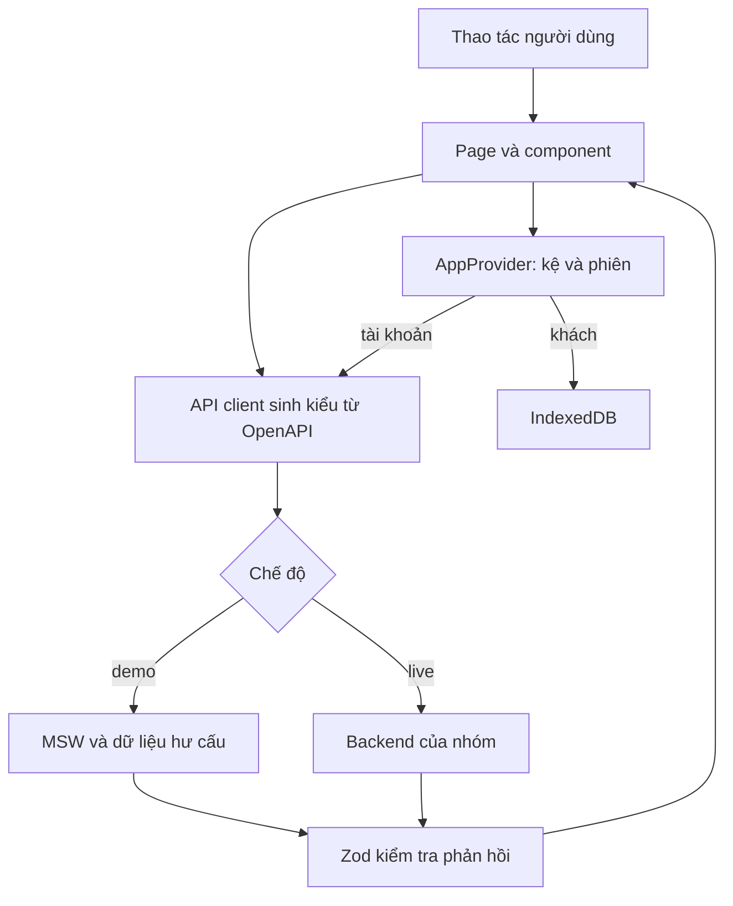

# Học từ bản triển khai Frontend Khám phá

Ngày thực hiện: 07/11/2026. Nhánh: `feature/frontend-discovery`.
Người dùng có nền tảng cơ bản, có khoảng 3–4 giờ học mỗi ngày.

## 1. Kết quả cần hiểu

Bạn có một ứng dụng hoạt động độc lập bằng MSW và có thể đổi sang API thật.
Đừng chỉ đọc trang đẹp: hãy tự lần theo một thao tác từ nút bấm tới dữ liệu lưu.
Mã ở đây được Codex thực hiện theo yêu cầu người dùng. Việc dùng GitHub Copilot
phải được thực hiện và ghi minh chứng riêng, không được gán tên Copilot cho phiên này.

## 2. Trình tự đã thực hiện và mục đích

1. **Kiểm tra Git và chỉ dẫn.** Repo sạch ở main, frontend chưa có package.json.
   Đọc AGENTS, README, SPEC, frontend instructions và hợp đồng API trước khi sửa.
2. **Tạo nhánh.** Tách thay đổi vào feature/frontend-discovery để nhóm review.
3. **Định nghĩa UI và dữ liệu.** Giữ GET /api/games trả mảng, thêm các trường
   tùy chọn và mô tả rõ request/response cho phần frontend sử dụng.
4. **Dựng React/Vite/TypeScript/Tailwind.** React quản lý component, Vite chạy
   và build, TypeScript kiểm tra kiểu, Tailwind và CSS tạo hệ thống trình bày.
5. **Dựng nguồn dữ liệu mẫu.** Viết game hư cấu và SVG gốc để kiểm tra các
   trường hợp; không biến fixture thành dữ kiện về boardgame ngoài đời.
6. **Tạo client và MSW.** Component gọi client; MSW thay API khi demo, không
   đặt mảng dữ liệu riêng trong từng trang. Có mô phỏng chậm/rỗng/503/429.
7. **Dựng khung và khám phá.** Sidebar, điều hướng, tìm kiếm, bộ lọc URL,
   phân trang và trạng thái tải/rỗng/lỗi; request cũ bị hủy để tránh ghi đè.
8. **Dựng gợi ý.** Form gửi query; hiển thị game cùng lý do; xử lý thất bại.
   Demo chỉ dùng lọc từ khóa, không giả làm LLM hay hội thoại có trí nhớ.
9. **Dựng kệ và lưu khách.** AppProvider giữ state chung, IndexedDB lưu bền
   trên trình duyệt; chỉ cập nhật thành công sau khi thao tác lưu hoàn tất.
10. **Tài khoản và gộp.** API nhận diện người từ phiên; frontend không gửi user_id.
    Gộp có thể gọi lại mà không tạo trùng; xóa kệ khách sau xác nhận thành công.
11. **Hoàn thiện.** Onboarding, trang học luật bàn giao, responsive, bàn phím,
    dialog có focus, nguồn dữ liệu, offline và PWA.
12. **Kiểm chứng và bàn giao.** Kiểm tra kiểu, test logic/component, trình duyệt
    desktop/di động, build; lưu bằng chứng và giới hạn thật trong nhật ký.

## 3. Sơ đồ luồng



## 4. Đọc mã theo thứ tự

| Tệp | Câu hỏi tự trả lời |
|---|---|
| frontend/index.html | React được gắn vào phần tử nào? |
| frontend/src/main.tsx | Vì sao đợi MSW trước khi render? |
| frontend/src/App.tsx | URL nào tương ứng trang nào? |
| frontend/src/app/Layout.tsx | Những phần nào dùng chung giữa các trang? |
| frontend/src/components/ui.tsx | GameCard nhận gì qua props? |
| frontend/src/pages/Discover.tsx | Bộ lọc nháp và URL đã áp dụng khác nhau thế nào? |
| frontend/src/hooks/useResource.ts | AbortController ngăn lỗi kết quả cũ bằng cách nào? |
| frontend/src/api/client.ts | Vì sao tất cả lời gọi mạng đặt ở một lớp? |
| frontend/src/api/models.ts | TypeScript khác kiểm tra runtime Zod thế nào? |
| frontend/src/mocks/handlers.ts | Mock thay mạng thế nào, dữ liệu nào chỉ là mẫu? |
| frontend/src/store/AppProvider.tsx | Ai là nguồn state chung của kệ? |
| frontend/src/storage/guest.ts | Vì sao đợi transaction complete mới báo lưu xong? |
| frontend/src/pages/Recommend.tsx | Những điều kiện nào được gửi cho dịch vụ? |
| frontend/src/components/ShelfEditor.tsx | Nhiều trạng thái cùng tồn tại ra sao? |

## 5. Luồng khám phá chi tiết

1. Người dùng chọn bộ lọc trong draft state.
2. Bấm Áp dụng: ghi q/players/time/weight vào URL; xóa page để về trang 1.
3. Discover đọc URL thành Filters và gọi useResource.
4. Client gọi GET /api/games; ở demo, MSW lọc cả catalog rồi mới phân trang.
5. API trả mảng, kèm X-Total-Count và X-Page-Size. CORS khác origin cần expose
   hai header này. Nếu thiếu total, UI không tự bịa tổng số.
6. Zod kiểm tra dữ liệu và GameCard trình bày. Metadata thiếu hiển thị là thiếu.
7. Thay URL/back/reload vẫn giữ bộ lọc. Request trước bị hủy khi đổi điều kiện.

Thời gian được hiểu là cận tối đa cho trường duration. Live backend phải thống nhất
duration có ý nghĩa tương đương. Không dùng giá trị trung bình nếu muốn cam kết cận tối đa.

## 6. Luồng kệ chi tiết

1. useApp cung cấp bản ghi của game cho mọi trang.
2. Nhãn played/owned/wishlist/disliked là boolean độc lập.
3. rating là null hoặc số nguyên 1–5; null không có nghĩa là 0 sao.
4. Khi khách lưu, guestStore viết IndexedDB. Khi có tài khoản, gọi PUT lên backend.
5. Chỉ sau xác nhận thành công mới cập nhật state và thông báo.
6. Bộ khóa theo game tránh gửi ghi đè khi cùng một thao tác còn đang chạy.
7. Epoch của phiên ngăn kết quả lưu cũ xuất hiện ở tài khoản khác sau chuyển phiên.

### Gộp khách

Tài khoản nhận nhãn bằng OR. Rating/notes đã có trong tài khoản được giữ;
nếu thiếu mới lấy từ khách. Gộp theo gameId nên gọi lại không tạo trùng.
Guest store chỉ clear sau response thành công. Nếu clear cục bộ thất bại,
có thể retry merge an toàn theo chính sách idempotent.

Trong live, máy chủ phải kiểm tra phiên, quyền, CSRF và dữ liệu. Mock mô phỏng
UX, không cung cấp bảo mật xác thực thật. Không lưu mật khẩu ở mock.

## 7. Điều gì là thật, điều gì còn mô phỏng?

| Thành phần | Tình trạng |
|---|---|
| Giao diện, điều hướng, lọc URL, xử lý lỗi | Mã frontend hoạt động |
| Lưu khách trên IndexedDB | Lưu thật trên trình duyệt |
| Game, hình minh họa, ba luật mẫu | Nội dung gốc nhưng hư cấu phục vụ demo |
| Gợi ý từ câu tự nhiên | Lọc từ khóa xác định trong MSW, chưa gọi LLM |
| Đăng nhập/đăng ký | Phiên demo, không xác thực mật khẩu thật |
| Gộp/xuất/xóa tài khoản | Luồng UI và API mock; live cần backend hiện thực |
| Google OAuth | Có xử lý chưa khả dụng; chưa tích hợp Google |
| PWA | Cấu hình build live; không cache API, demo dùng MSW riêng |
| Hỏi luật RAG, quản trị, hỏi lịch sử | Chưa thuộc kết quả bàn giao này |
| So sánh Copilot với công cụ khác | Chưa thực hiện; không có số liệu để kết luận |

## 8. Kế hoạch tự học với 3–4 giờ/ngày

- **Buổi 1:** chạy ứng dụng, đọc main/App/Layout, tự đổi một câu chữ và giải thích.
- **Buổi 2:** đọc GameCard, tự thêm metadata tùy chọn và kiểm tra khi thiếu dữ liệu.
- **Buổi 3:** đọc Discover, thêm test một tổ hợp bộ lọc và thử back/reload URL.
- **Buổi 4:** đọc client/MSW, bật từng tình huống lỗi; nhận diện request trong Network.
- **Buổi 5:** đọc AppProvider/guestStore, lưu rồi tải lại; kiểm tra IndexedDB DevTools.
- **Buổi 6:** thực hiện gộp thất bại rồi thành công, giải thích thứ tự và idempotence.
- **Buổi 7:** đọc test và chạy Playwright; review bằng GitHub Copilot rồi lưu bằng chứng thật.
- **Sau đó:** phối hợp backend, dùng dữ liệu được duyệt, kiểm thử tích hợp và viết báo cáo.

Mỗi buổi dành khoảng 30 phút đọc khái niệm, 90 phút đọc/sửa mã, 30–45 phút
kiểm tra và 15–20 phút ghi chú. Tự thực hiện ít nhất một thay đổi nhỏ không sao chép.

## 9. Prompt dùng GitHub Copilot để học và review

```text
Đọc AGENTS.md, frontend instructions, docs/openapi.yaml và GameCard.
Chưa sửa mã. Giải thích dữ liệu đi từ API tới thẻ game như thế nào.
Đặt cho tôi 3 câu hỏi kiểm tra hiểu và chỉ ra trường hợp thiếu dữ liệu cần thử.
```

```text
Review AppProvider và guestStore. Kiểm tra trường hợp lưu thất bại,
gộp thất bại và đổi tài khoản khi request còn chạy. Chỉ báo lỗi có bằng chứng
từ mã hoặc test. Đề xuất test mô tả hành vi người dùng, chưa sửa hàng loạt.
```

Ghi tool/chế độ/model nếu giao diện hiển thị, prompt, output, nhận xét của bạn,
diff được chấp nhận và kết quả kiểm chứng. Không ước lượng thời gian tiết kiệm
thành số liệu thực đo; không tạo ảnh hoặc hội thoại giả làm bằng chứng.

## 10. Checklist trước khi ghép backend

- Nhóm review thay đổi OpenAPI và chính sách gộp; tạo PR sửa hợp đồng.
- Backend hiện thực các endpoint và shape giống hợp đồng; xác thực/CSRF ở server.
- Đặt VITE_API_MODE=live; bảo đảm thông báo demo biến mất và mock không khởi động.
- Thử Network: filter, page, sort, auth cookie, 401, 429, 503 và phản hồi sai schema.
- Thử hai tài khoản: không hiển thị kệ người trước; server không trả dữ liệu chéo.
- Không đưa API key LLM vào frontend. Chỉ API server được gọi dịch vụ LLM.
- Thay game mẫu bằng dữ liệu đã kiểm tra nguồn/giấy phép; không nhầm metadata hư cấu.
- Chạy lại kiểm chứng sau thay đổi tích hợp. Không gọi mock test là test backend thật.

## 11. Báo cáo và bảo vệ

Chuẩn bị một luồng demo: lọc 4 người/30 phút → xem game → lưu và chấm sao →
reload kệ → nhập nhu cầu gợi ý → thử tình huống không có kết quả.
Một luồng khác: lưu khách → đăng nhập mẫu → gộp thất bại → retry thành công.

Tự giải thích được props/state, URL state, mock/live, compile/runtime validation,
IndexedDB transaction, cookie phiên, điều kiện cứng và thiếu bằng chứng.
Mô tả giới hạn đúng với bảng ở mục 7. Chỉ báo cáo những việc đã thực hiện.
