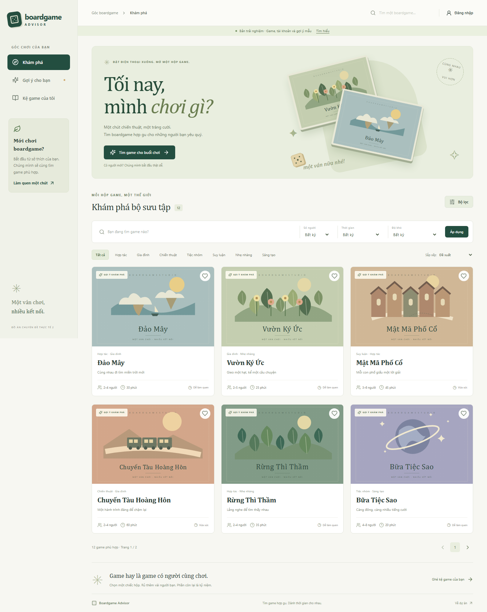
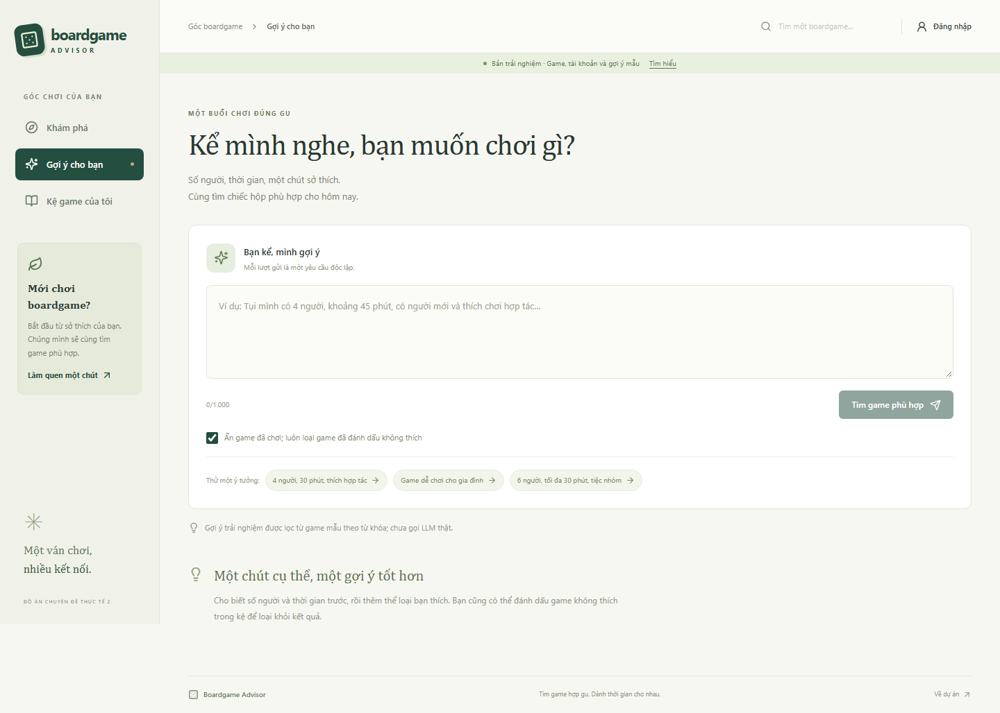
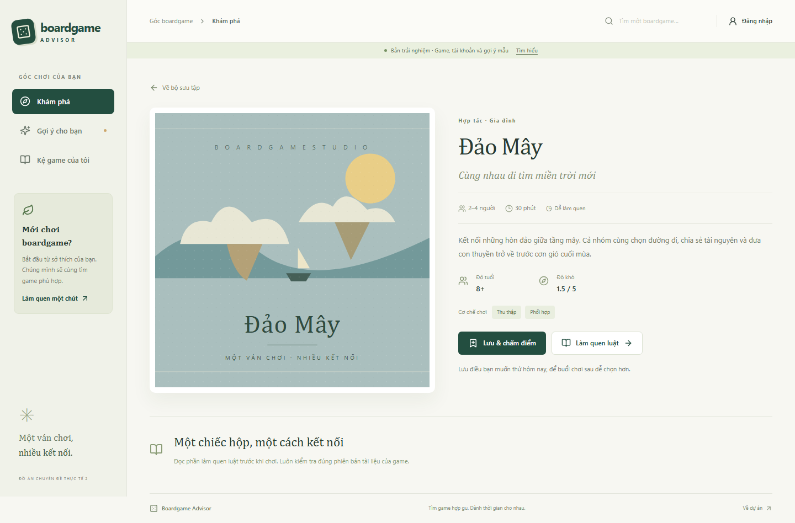

# Kết quả Frontend Khám phá — bản bàn giao 07/11/2026

## Bài toán và phạm vi

Người dùng cần tìm boardgame phù hợp với số người, thời gian và sở thích;
xem lý do gợi ý; ghi nhớ game muốn thử, đã chơi, sở hữu hoặc không thích.
Phần giao diện phải dùng được khi chưa đăng nhập và phản ánh đúng lỗi dịch vụ.

Phạm vi bản này là Thành viên 3: hệ thống thiết kế, khung ứng dụng, tìm/lọc,
chi tiết, gợi ý, onboarding, kệ cá nhân, tài khoản/gộp khách, PWA và kiểm thử.
Có trang làm quen luật tối thiểu để bàn giao. Hỏi luật RAG và quản trị chưa được
triển khai trong phạm vi này.

## Giải pháp

- React + TypeScript tổ chức page/component. React Router quản lý điều hướng.
- Tailwind qua Vite và CSS chung định nghĩa hệ thống thiết kế.
- OpenAPI là hợp đồng; openapi-typescript sinh kiểu và openapi-fetch gọi API.
- Zod kiểm tra dữ liệu lúc chạy, vì kiểu TypeScript không xác thực response mạng.
- MSW mô phỏng API trong demo; live không tự thay dịch vụ lỗi bằng mẫu.
- URL giữ bộ lọc. AbortController hủy request cũ; có timeout 20 giây.
- Context dùng chung kệ/phiên; IndexedDB lưu kệ khách theo transaction.
- Gộp idempotent theo gameId, chỉ xóa dữ liệu khách sau khi được xác nhận.
- Live PWA cache tài nguyên ứng dụng; không cache API hay dữ liệu cá nhân.

## Kết quả triển khai

| Chức năng | Kết quả và giới hạn |
|---|---|
| Danh sách/bộ lọc | Có số người, thời gian, độ khó, thể loại, tên, sort, page và URL |
| Chi tiết | Hiển thị metadata, thông tin thiếu, nhãn, sao và ghi chú |
| Gợi ý | Có UI và endpoint mock; lọc từ khóa trong 12 game hư cấu, chưa gọi LLM |
| Kệ khách | Lưu IndexedDB thật, giữ qua reload |
| Tài khoản | Có UI và phiên mô phỏng; live cần backend xác thực |
| Gộp kệ | Có lỗi/retry, chính sách xung đột và giữ dữ liệu khi thất bại |
| Onboarding | Đánh dấu game từng chơi, chấm sao, bỏ qua |
| Google | UI hiển thị chưa khả dụng trong demo; chưa có OAuth thật |
| Xuất/xóa dữ liệu | Giao diện và API mock; backend thật chưa hiện thực |
| PWA | Live build có manifest, icon, worker, offline shell và thông báo cập nhật |
| Responsive | Kiểm tra 360/390/768/1440 px; chưa thử thiết bị thật/Safari |

Ảnh sản phẩm:

Ảnh bổ sung nằm trong docs/screenshots, gồm login, onboarding, kệ và điện thoại.

## Đánh giá đã thực hiện

- Kiểm tra kiểu TypeScript và sinh kiểu từ hợp đồng API.
- 15 kiểm thử logic/component: điều kiện cứng, metadata thiếu, tìm không dấu,
  thứ tự sort, gợi ý, merge idempotent, IndexedDB và GameCard.
- 16 kiểm thử Playwright: 8 tình huống trên desktop và viewport di động Chromium.
  Bao gồm bộ lọc/reload/chi tiết, kệ khách, gợi ý, gộp thất bại, 503/429,
  đường dẫn trực tiếp, phiên hết hạn và điều hướng bàn phím.
- Kiểm tra trực quan 6 route ở 4 độ rộng; kiểm tra không tràn ngang.
- Build live và demo; kiểm tra manifest, worker, offline shell, không cache API
  và không dùng dữ liệu mẫu làm fallback trong live.

Các kiểm thử frontend không chứng minh độ đúng của LLM, bảo mật backend, chất
lượng gợi ý thực tế hay mức hài lòng người dùng. Chưa có khảo sát người dùng,
Hit@5 thực tế hoặc so sánh công cụ AI được thực hiện trong bản này.

## Minh chứng sử dụng AI

Codex tham gia phân tích hiện trạng, thiết kế, hiện thực và kiểm thử trong phiên
người dùng yêu cầu làm trực tiếp. Nhật ký: docs/AI_LOG.md. Giải thích từng bước
và bài tập tự học: docs/FRONTEND_GUIDE.md. Kế hoạch so sánh công cụ chưa điền số
liệu: docs/AI_TOOL_COMPARISON.md.

## Những vấn đề phát hiện và xử lý

- Label bộ lọc chưa có tên truy cập chính xác: thêm aria-label, kiểm tra trình duyệt.
- Điều khiển Bộ lọc ban đầu chỉ thay đổi trên mobile: đồng bộ đóng/mở trên mọi viewport.
- Phiên hết hạn nhưng state vẫn giữ user làm trang đăng nhập chuyển hướng:
  xóa state phiên cũ, giữ draft và cho phép đăng nhập lại; có test hồi quy.
- Sidebar mobile bị đưa ra ngoài màn hình nhưng còn focus được: dùng inert,
  chuyển focus khi mở/đóng, Escape và giữ Tab trong menu.
- Font serif ban đầu tách dấu ở một số chữ tiếng Việt: đổi sang Cambria và xem lại ảnh.
- Test ban đầu đếm sai số game khớp: đối chiếu toàn bộ catalog, sửa kỳ vọng và
  kiểm tra game ở trang sau xuất hiện sau lọc. Không sửa dữ liệu để làm test đạt.

## Công việc cần phối hợp tiếp

Nhóm review hợp đồng API qua PR, hiện thực backend/LLM, thay dữ liệu mẫu bằng
dữ liệu đã được duyệt và chạy kiểm thử tích hợp. Sau đó thử người dùng, đo chất
lượng gợi ý và thực hiện so sánh công cụ AI bằng bằng chứng thật.
